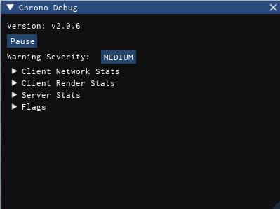
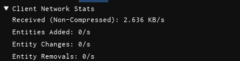
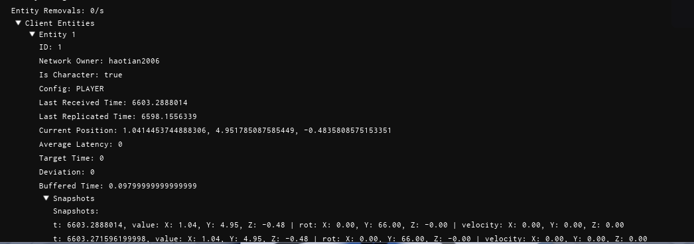
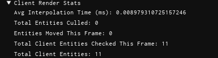
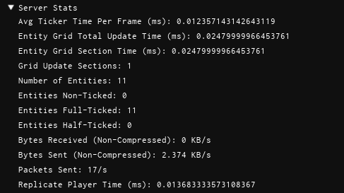
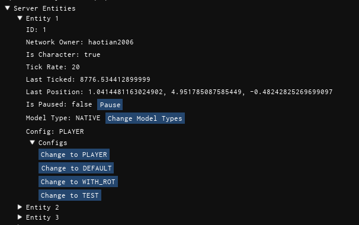
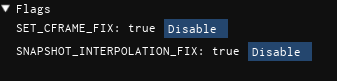

# Using the Debugger

Chrono includes a client-side debugger that shows live snapshots, timing data and settings.

## Setup

1. Put `debugger.luau` from the [latest release](https://github.com/Parihsz/Chrono/releases/latest) in a LocalScript. You can also use [test/Debugger/init.client.luau](https://github.com/Parihsz/Chrono/blob/master/test/Debugger/init.client.luau).
2. Install Iris through your package manager or from [SirMallard/Iris](https://github.com/SirMallard/Iris/releases/latest).
3. Update the paths at the top of the script to match your game:

```lua
local PAUSE_KEY = Enum.KeyCode.E
local OPEN_CLOSE_KEY = Enum.KeyCode.F3
local CHRONO = ReplicatedStorage.Packages.chrono -- Replace with your Chrono path
local IRIS = ReplicatedStorage.DevPackages.iris -- Replace with your Iris path
```

## Permissions

The debugger only opens for players with permission. Grant it on the server:

```lua
-- Script in ServerScriptService
local Players = game:GetService("Players")
local ReplicatedStorage = game:GetService("ReplicatedStorage")
local RunService = game:GetService("RunService")
local Stats = require(ReplicatedStorage.Packages.chrono).Stats

local DEVELOPERS = {
	[123456789] = true, -- your UserId
}

Players.PlayerAdded:Connect(function(player)
	if DEVELOPERS[player.UserId] or RunService:IsStudio() then
		Stats.ReplicateStatsForPlayer(player) -- or Stats.ReplicateStatsForPlayer(player.UserId)
	end
end)
```

Revoke permission with `Stats.StopReplicatingStatsForPlayer(player)`.

!!! warning
    Use `ReplicateStatsForPlayer` to grant permission. Adding UserIds to `Stats.REPLICATE_PERMISSIONS` from your scripts doesn't grant debugger access.

## Using the debugger

Press F3 to open or close it, and E to pause it. Change these with `OPEN_CLOSE_KEY` and `PAUSE_KEY`.

!!! warning
    The debugger receives server stats every frame while open. Close it when measuring normal bandwidth.



The top section shows:

- Chrono's version
- Pause and resume controls
- The game's [warning severity](../getting-started/configurations.md#warning-severity) control

## Client network stats



This section shows what the client is receiving:

- Uncompressed kilobytes received per second for entity replication
- New entities, changes and removals per second

### Client entities



This lists every entity registered on the client. Expand one to see:

- Entity ID, owner and player character status
- Latest snapshot time and current position
- Last send time for client-owned entities
- Snapshot history, including position, rotation and velocity

It also shows the entity's interpolation timing:

- **Target time**: the render time, on the server's clock for server-owned entities or the owner's clock for client-owned ones.
- **Buffered time**: interpolation delay in seconds.
- **Average latency**: smoothed packet lateness relative to the clock's estimate. Usually near 0 on a steady connection. This isn't ping.
- **Deviation**: packet timing jitter. Automatic buffers account for twice this value.

Entities with a fixed `BUFFER` show 0 for average latency and deviation, because only automatic buffers track them.

!!! tip
    For choppy movement with high deviation, try raising `MIN_BUFFER` or the type's `BUFFER`. If the entity stalls, check whether new snapshots are arriving.

## Client render stats



This section shows interpolation stats for the client:

- Average interpolation time
- Entities culled, moved and checked this frame
- Total client entities

## Server stats



This section shows server-side replication:

- Average ticker time
- Total grid update time, average section time and sections updated ([grid settings](../getting-started/configurations.md#grid-updates))
- Total entities and counts at each tick rate
- Uncompressed kilobytes received and sent per second for entity replication
- Packets sent per second and average replication time per player

### Server entities



This lists every entity registered on the server. Expand one to see:

- Entity ID, owner and player character status
- Tick rate, last tick time and position
- Pause and resume controls. Paused `NATIVE` models fall back to Roblox replication.
- Model replication mode, with a toggle between `NATIVE` and `NATIVE_WITH_LOCK`
- Entity type, with a control to switch types

## Flags


Flags are just values that enable features or behaviors. These are mainly used for debugging and testing purposes and can be ignored. Setting a flag will update the value on the server and replicate it to all clients.
