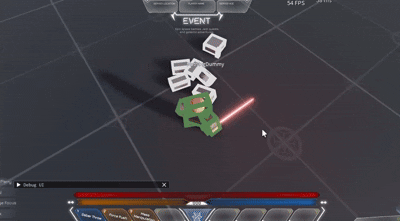

# Ragdolls

Ragdolls have been a pain point for many of us, especially with custom character replication.



## Ragdolls with ALIGN mode (v2.2.0+)

Setting the primary part's `CFrame` every frame can make ragdolls jitter. `ALIGN` mode uses `AlignPosition` and `AlignOrientation` to move with physics, allowing many existing ragdoll systems to work with Chrono.

Switch the entity to `ALIGN` when it ragdolls, and back to `CFRAME` when it gets up:

```lua
-- Server
local Players = game:GetService("Players")
local ReplicatedStorage = game:GetService("ReplicatedStorage")
local chrono = require(ReplicatedStorage.Packages.chrono)

local function SetRagdolled(character: Model, ragdolled: boolean)
	local player = Players:GetPlayerFromCharacter(character)
	local entity = player and chrono.Holder.GetEntityFromPlayer(player)
	if not entity then
		return
	end
	if ragdolled then
		chrono.Entity.SetInterpolationMode(entity, "ALIGN")
		RAGDOLL(character) -- your ragdoll code
	else
		UN_RAGDOLL(character) -- your ragdoll code
		chrono.Entity.SetInterpolationMode(entity, "CFRAME")
	end
end
```

For an NPC, find its entity with `chrono.Holder.GetEntityFromModel(model)` instead.

Server calls to `SetInterpolationMode` replicate to every client. In `ALIGN` mode, Chrono also replicates Humanoid states and disabled states. `Ragdoll` is applied as `Physics`.

!!! warning
    `ALIGN` is experimental. Use it only while ragdolled. Report bugs on [GitHub](https://github.com/Parihsz/Chrono/issues), the [Developer Forum](https://devforum.roblox.com/t/chrono-drop-in-custom-physics-replication-library/3873294), or [Discord](https://discord.gg/wEEqrVwV5a).

### Rotation

`PLAYER` sends only yaw by default. Register a full-rotation type so clients can see the ragdoll tilt:

```lua
-- In your config module
Config.RegisterEntityType("PLAYER_RAGDOLL", {
	TICK_RATE = 1 / 20,
	BUFFER = 0, -- automatic, like PLAYER
	FULL_ROTATION = true,
	MODEL_REPLICATION_MODE = "NATIVE", -- match the mode your players use
	HALF_TICK_DISTANCE = math.huge, -- always sent, like PLAYER
})
```

```lua
-- Server: when ragdolling, and when getting up
chrono.Entity.SetConfig(entity, "PLAYER_RAGDOLL")
chrono.Entity.SetConfig(entity, "PLAYER")
```

You can instead re-register `PLAYER` itself with `FULL_ROTATION = true`.

## How we implement ragdolls (CLIENT SIDED RAGDOLLS)
To implement ragdolls we have a dual skeleton approach where:

* Calculation skeleton does the physics simulation
* Visual skeleton mirrors the physics skeleton's cframes for rendering

!!! note
	For this demo we recommend NOT using ALIGN mode as it has been found to cause issues.

## Ragdoll System
Grab the ragdoll script and rigtypes module [here](https://gist.github.com/Parihsz/4eaf5f5d91cd084a3c06e6b1bb088c08). Note that this was made for R6 but the same concept applies for R15.

## Set up collision groups
Ragdoll parts need their own collision rules so they don't collide with active combatants but DO collide with the world and each other.
```lua
local PhysicsService = game:GetService("PhysicsService")

PhysicsService:RegisterCollisionGroup("Combatants")
PhysicsService:RegisterCollisionGroup("Combatants2")
PhysicsService:RegisterCollisionGroup("Ragdoll")

PhysicsService:CollisionGroupSetCollidable("Combatants2", "Combatants", false)
PhysicsService:CollisionGroupSetCollidable("Combatants2", "Combatants2", false)

PhysicsService:CollisionGroupSetCollidable("Ragdoll", "Default", true)
PhysicsService:CollisionGroupSetCollidable("Ragdoll", "Combatants", false)
PhysicsService:CollisionGroupSetCollidable("Ragdoll", "Combatants2", false)
PhysicsService:CollisionGroupSetCollidable("Ragdoll", "Ragdoll", true)

Players.PlayerAdded:Connect(function(player)
    player.CharacterAdded:Connect(function(character)
        for _, part in character:GetDescendants() do
            if part:IsA("BasePart") then
                part.CollisionGroup = "Combatants"
            end
        end
    end)
end)
```

### Configure Chrono for ragdolls
For R6 rigs, we recommend setting `PrimaryPart` to `HumanoidRootPart` as soon as `CharacterAdded` fires:
```lua
character.PrimaryPart = character:WaitForChild("HumanoidRootPart")
```
For full rotation, use a separate entity type as shown above:
```lua
local Config = require(chrono.Shared.Config)

Config.RegisterEntityType("PLAYER_RAGDOLL", {
    TICK_RATE = 1 / 20,
    FULL_ROTATION = true,
    MODEL_REPLICATION_MODE = "NATIVE",
})
```

Then swap entity types when ragdolling:

```lua
local entity = Holder.GetEntity(character) --before ragdoll:
Chrono.Entity.SetConfig(entity, "PLAYER_RAGDOLL")
Ragdoll.SetRagdollEnabled(character)

--after ragdoll:
Ragdoll.SetRagdollDisabled(character)
Chrono.Entity.SetConfig(entity, "PLAYER")
```

If you need to keep the Head as `PrimaryPart`, modify the ragdoll script to use a second skeleton:
```lua

local function ToggleLocalTransparency(model: Model, transparency)
	for i, v in model:QueryDescendants("BasePart") do
		v = v :: BasePart
		if not v:HasTag("RAG_DOLL_COPY") then
			v.LocalTransparencyModifier = transparency
		end
	end
end

-- Activating ragdoll on an arbitrary model with a Humanoid:
local function EnableRagdoll(model: Model)
	local isSelfRagdoll = RunService:IsClient() and model == Players.LocalPlayer.Character

	local original = model
	if not isSelfRagdoll then
		ToggleLocalTransparency(model, 1)

		model.Archivable = true
		model = model:Clone()
		model:RemoveTag(SHOULD_RAGDOLL_TAG)
		model.Archivable = false
		model.Name = MODEL_COPY
		model.Parent = original

		for _, limb in model:QueryDescendants("BasePart") do
			limb = limb :: BasePart
			limb:AddTag("RAG_DOLL_COPY")
		end

		task.spawn(function()
			local function GetPart(model)
				if model:FindFirstChild("HumanoidRootPart") then
					return model:FindFirstChild("HumanoidRootPart")
				elseif model.PrimaryPart then
					return model.PrimaryPart
				end
				return Instance.new("Part")
			end

			while model.Parent ~= nil do
				GetPart(model).CFrame = GetPart(original).CFrame
				RunService.Heartbeat:Wait()
			end
		end)
	end

	... rest of the ragdoll script
end
```

Try the [open-source demo](https://www.roblox.com/games/78492181198483/rep-test).
